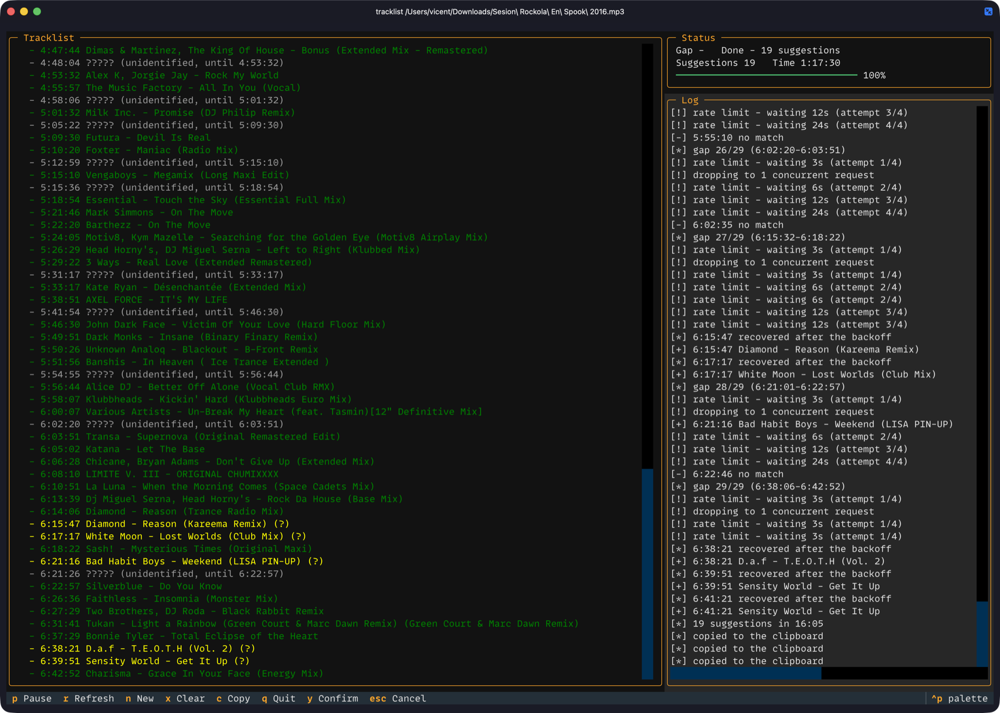

# tracklist

[English](README.md) · **Español**

Genera un tracklist con timestamps de un video de YouTube (un set de DJ, una mezcla, un programa de radio) a partir de las reclamaciones de Content ID de YouTube, y rellena los huecos con Shazam.

```
Sunday Session — Live Mix
https://www.youtube.com/watch?v=XXXXXXXXXXX

  - 00:00 Artist One - First Track
  - 04:12 Artist Two - Second Track (?)
  - 09:30 ????? (sin identificar, hasta 12:05)
  - 12:05 Artist Three - Third Track

2 identificados, 1 sugeridos, 1 huecos (02:35 sin identificar de 15:40)
```



## Cómo funciona

1. **Reclamaciones de Content ID.** Cuando un video contiene música con derechos de autor, el Content ID de YouTube le adjunta una reclamación con la canción, el artista, el sello y la posición exacta en el video. tracklist lee estas reclamaciones de YouTube Studio usando la sesión de YouTube de tu navegador, así que nunca tienes que copiar cookies ni un comando cURL a mano.
2. **Tu video o el de otra persona.** Studio solo muestra reclamaciones de videos de tu propio canal:
   - **Tu video:** las reclamaciones se leen al instante.
   - **El video de otra persona:** tracklist descarga el audio con `yt-dlp`, lo sube como video **privado** a tu canal mediante la API de datos de YouTube, espera a que se procese y a que termine Content ID (hasta una hora), y entonces lee las reclamaciones de esa copia.
   - **Un fichero de audio local:** se convierte en video con `ffmpeg` (la imagen es la forma de onda de la grabación) y se sube de la misma manera.
3. **Shazam para los huecos.** Cada tramo de 90 segundos o más sin reclamación se muestrea cada 90 segundos (clips de 10 segundos) y se reconoce con Shazam. Las coincidencias de Shazam se marcan con `(?)`, se fusionan con las muestras vecinas de la misma canción y se descartan si repiten una canción ya reclamada. Lo que sigue sin identificar se lista como `?????` con su rango de tiempo.
4. **Plan B.** Con una URL de YouTube, si no se puede subir nada (cuota de subidas agotada, sin sesión de Google, descarga fallida, sin sesión de Studio), tracklist escanea todo el video solo con Shazam. Un fichero local no tiene video al que recurrir, así que con la cuota agotada tracklist se detiene.
5. **Limpieza.** Al terminar, te ofrece borrar la copia privada que subió.

El progreso se guarda en caché, así que un análisis interrumpido continúa donde se quedó.

## Instalación

Requiere macOS. Abre la Terminal, pega esta línea y pulsa Enter. Instala Homebrew si no lo tienes y después todo lo que tracklist necesita:

```bash
curl -fsSL https://raw.githubusercontent.com/vigosan/tracklist/main/install.sh | bash
```

Si ya usas Homebrew y prefieres hacerlo a mano:

```bash
brew install yt-dlp ffmpeg uv
uv tool install git+https://github.com/vigosan/tracklist
```

Para actualizar, ejecuta `tracklist update`. Una vez al día, al abrir tracklist, comprueba en GitHub si hay una versión nueva y muestra un aviso de una línea si la hay (nunca se actualiza solo; sin conexión, se salta la comprobación).

## Qué navegador

tracklist lee la sesión de YouTube de un navegador en el que hayas iniciado sesión, así que necesita saber cuál.

- **Automático:** detecta el navegador que tiene la sesión y lo recuerda. Si ese navegador pierde la sesión más adelante, cambia a otro con sesión iniciada.
- **A tu elección:** pasa `--browser` con uno de chrome, brave, edge, firefox, safari, vivaldi, opera o chromium, por ejemplo `tracklist <URL> --browser safari`. tracklist lo recuerda para las siguientes ejecuciones y, en la ejecución en que lo pasas, usa solo ese navegador.
- **Safari** necesita "Acceso total al disco" para tu app de terminal (Terminal, iTerm, Ghostty...) en Ajustes del Sistema > Privacidad y seguridad.

## Primera ejecución

Antes de empezar, asegúrate de tener:

- un canal de YouTube en tu cuenta de Google, porque las reclamaciones de Content ID y las subidas viven ahí
- esa cuenta de Google con la sesión iniciada en YouTube en tu navegador (consulta [Qué navegador](#qué-navegador))

Después ejecuta `tracklist <URL>` como de costumbre. La primera vez, tracklist hace una configuración única que lleva unos 5 minutos y no se vuelve a pedir:

1. **Permitir el acceso a las cookies del navegador.** macOS te pide la contraseña del llavero para que tracklist pueda leer la sesión de YouTube del navegador. Elige "Permitir siempre" para que no la pida en cada ejecución.
2. **Crear tu propia credencial de Google.** tracklist sube a tu canal a través de tu propio proyecto de Google, que es gratuito. Un asistente te abre cada página de Google Cloud y te dice qué hacer:
   1. Crea un proyecto: escribe `tracklist` como nombre del proyecto y haz clic en Crear.
   2. Activa la YouTube Data API v3: haz clic en Habilitar.
   3. Configura la app: escribe `tracklist` como nombre de la app, elige tu propio correo como correo de asistencia y como correo de contacto, y elige el público Externo.
   4. Haz clic en "Publicar app" para que el inicio de sesión no caduque cada 7 días. Google muestra un aviso de app sin verificar: es tu propia app, así que continúa.
   5. Crea un cliente OAuth: elige "Aplicación de escritorio" como tipo, escribe `tracklist` como nombre, haz clic en Crear y descarga el JSON.

   De vuelta en la terminal, pulsa Enter y tracklist recoge el nuevo `client_secret*.json` de `~/Downloads`, o pega la ruta del JSON.
3. **Autorizar tracklist.** Se abre tu navegador para que inicies sesión con Google y apruebes el acceso. El permiso que pide Google (`youtube`) da a tracklist control sobre tu canal; solo sube copias privadas y borra las copias que él mismo subió.

Después de eso, tracklist empieza a analizar el video.

## Uso

Indica a tracklist qué analizar con un solo argumento, ya sea un video de YouTube o un fichero de audio de tu Mac:

- **Un video de YouTube:** pega su URL o solo el ID de 11 caracteres. Vale cualquier forma (`watch?v=`, `youtu.be/`, un enlace de Studio).
- **Un fichero de audio local:** da su ruta, por ejemplo `tracklist ~/Music/set.mp3`. Vale cualquier formato que `ffmpeg` lea (mp3, m4a, wav, flac...). Pon la ruta entre comillas si tiene espacios, o arrastra el fichero desde el Finder a la terminal.
- **Nada:** ejecuta `tracklist` solo y te pregunta la URL, el ID o la ruta del fichero.

El tracklist empieza con el título del video (para un fichero local, su nombre sin la extensión), luego el enlace, y `c` en la interfaz de terminal lo copia todo.

```bash
tracklist https://www.youtube.com/watch?v=XXXXXXXXXXX   # tu propio video
tracklist https://www.youtube.com/watch?v=YYYYYYYYYYY   # el video de otra persona
tracklist XXXXXXXXXXX                                    # lo mismo, por ID de video
tracklist set.mp3                                        # un fichero de audio local
tracklist "~/Music/Sunday Session.m4a"                   # una ruta con espacios
tracklist                                                # pregunta qué analizar
tracklist <URL> --browser brave                          # elige el navegador
tracklist <URL> --fresh                                  # ignora cualquier análisis previo
tracklist <URL> --label                                  # muestra el sello de cada canción
```

Otras opciones: `--no-recognize` (omite Shazam), `--from-json FILE` (usa una respuesta de reclamaciones guardada), `--duration SECONDS` (duración total, para el hueco final).

Content ID puede tardar en reportar las reclamaciones de una subida nueva. Puedes salir durante esa espera y ejecutar el mismo comando más tarde: continúa desde la subida existente y nunca espera dos veces salvo que pases `--fresh`. La interfaz de terminal muestra las reclamaciones según llegan, y una notificación de macOS te avisa cuando el tracklist está listo. También muestra el progreso de la descarga, la conversión y la subida, y después la espera de Content ID. Salir durante la descarga o la conversión las detiene limpiamente, y salir durante la subida pregunta antes, porque la siguiente ejecución la sube otra vez y gasta cuota.

Mientras se ejecuta, una interfaz de terminal muestra el tracklist a medida que crece:

| Tecla | Acción |
|-------|--------|
| `p` | pausar / reanudar Shazam |
| `r` | actualizar las reclamaciones de Content ID |
| `n` | analizar otro video |
| `x` | descartar las sugerencias de Shazam y empezar de nuevo (confirma con `s`) |
| `c` | copiar el tracklist |
| `q` | salir |

## Idioma

tracklist habla inglés o español, según la configuración regional de tu sistema (`LC_ALL`, `LC_MESSAGES`, luego `LANG`). Una configuración que empiece por `es` da español, cualquier otra da inglés. Para cambiarlo en una ejecución:

```bash
LC_ALL=es_ES.UTF-8 tracklist <URL>
```

En español, las preguntas de sí/no y la tecla de confirmación de la interfaz usan `s` en lugar de `y`.

Este README también está disponible en inglés: [README.md](README.md).

## Límites

- Unas 6 subidas al día: la cuota de la API pertenece a tu propio proyecto de Google.
- Content ID tarda hasta una hora en revisar una subida.
- Los videos de otras personas se suben como privados, y se te ofrece borrarlos al terminar.

## Datos guardados

- `~/.config/tracklist`: navegador elegido, credencial y sesión de Google, caché de análisis.
- `~/Library/Caches/tracklist`: audio descargado, para poder continuar un análisis.
