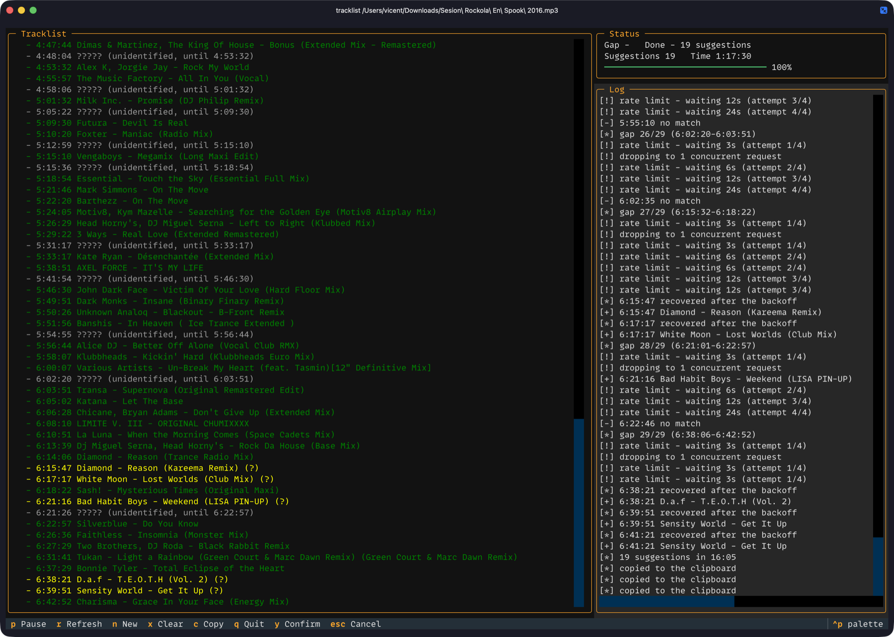

# tracklist

Builds a timestamped tracklist for a YouTube video (a DJ set, a mix, a radio show) from YouTube's Content ID claims, and fills the gaps with Shazam.

```
Sunday Session — Live Mix
https://www.youtube.com/watch?v=XXXXXXXXXXX

  - 00:00 Artist One - First Track
  - 04:12 Artist Two - Second Track (?)
  - 09:30 ????? (unidentified, until 12:05)
  - 12:05 Artist Three - Third Track

2 identified, 1 suggested, 1 gaps (02:35 unidentified of 15:40)
```



## How it works

1. **Content ID claims.** When a video contains copyrighted music, YouTube's Content ID attaches a claim to it with the song, artist, label and the exact position in the video. tracklist reads these claims from YouTube Studio using your browser's YouTube session, so you never have to copy cookies or a cURL command by hand.
2. **Your video or someone else's.** Studio only shows claims for videos on your own channel:
   - **Your video:** the claims are read straight away.
   - **Someone else's video:** tracklist downloads the audio with `yt-dlp`, uploads it as a **private** video to your channel through the YouTube Data API, waits for processing and for Content ID to finish (up to an hour), and then reads the claims of that copy.
   - **A local audio file:** it is converted to a video with `ffmpeg` (the picture is the recording's waveform) and uploaded the same way.
3. **Shazam for the gaps.** Any stretch of 90 seconds or more without a claim is sampled every 90 seconds (10-second clips) and recognised with Shazam. Shazam matches are marked with `(?)`, merged with neighbouring samples of the same track, and dropped when they repeat a claimed track. Whatever stays unidentified is listed as `?????` with its time range.
4. **Fallback.** For a YouTube URL, if nothing can be uploaded (upload quota used up, no Google login, download failed, no Studio session), tracklist scans the whole video with Shazam alone. A local file has no video to fall back on, so with the quota used up tracklist stops.
5. **Cleanup.** At the end it offers to delete the private copy it uploaded.

Progress is cached, so an interrupted analysis resumes where it stopped.

## Install

Requires macOS with Homebrew.

```bash
brew install yt-dlp ffmpeg uv
uv tool install git+https://github.com/vigosan/tracklist
```

To update, run `tracklist update`.

## Which browser

tracklist reads the YouTube session of a browser where you are signed in, so it needs to know which one.

- **Automatic:** it detects the browser that has the session and remembers it. If that browser later loses its session, it switches to another one that is signed in.
- **Your choice:** pass `--browser` with one of chrome, brave, edge, firefox, safari, vivaldi, opera or chromium, for example `tracklist <URL> --browser safari`. tracklist remembers it for the next runs, and in the run where you pass it uses only that browser.
- **Safari** needs "Full Disk Access" for your terminal app (Terminal, iTerm, Ghostty...) in System Settings > Privacy & Security.

## First run

Before you start, make sure you have:

- a YouTube channel on your Google account, because Content ID claims and uploads live there
- that Google account signed in to YouTube in your browser (see [Which browser](#which-browser))

Then run `tracklist <URL>` as usual. The first time, tracklist does a one-time setup that takes about 5 minutes and is never asked again:

1. **Allow access to the browser's cookies.** macOS asks for your keychain password so tracklist can read the browser's YouTube session. Choose "Always Allow" so it doesn't ask on every run.
2. **Create your own Google credential.** tracklist uploads to your channel through your own Google project, which is free. A wizard opens each Google Cloud page for you and tells you what to do:
   1. Create a project: type `tracklist` as the project name and click Create.
   2. Enable the YouTube Data API v3: click Enable.
   3. Set up the app: type `tracklist` as the app name, pick your own email as the support email and as the contact email, and choose audience External.
   4. Click "Publish app" so the login doesn't expire every 7 days. Google shows an unverified app warning: it's your own app, so continue.
   5. Create an OAuth client: choose "Desktop app" as the type, type `tracklist` as the name, click Create and download the JSON.

   Back in the terminal, press Enter and tracklist picks up the new `client_secret*.json` from `~/Downloads`, or paste the JSON's path.
3. **Authorise tracklist.** Your browser opens so you can sign in with Google and approve access. The permission Google asks for (`youtube`) gives tracklist control of your channel; it only uploads private copies and deletes the copies it uploaded.

After that, tracklist starts analysing the video.

## Usage

Tell tracklist what to analyse in one argument, either a YouTube video or an audio file on your Mac:

- **A YouTube video:** paste its URL or just the 11-character video ID. Any form works (`watch?v=`, `youtu.be/`, a Studio link).
- **A local audio file:** give its path, for example `tracklist ~/Music/set.mp3`. Any format `ffmpeg` reads works (mp3, m4a, wav, flac...). Quote the path if it has spaces, or drag the file from Finder into the terminal.
- **Nothing:** run `tracklist` alone and it asks for the URL, ID or file path.

The tracklist starts with the video's title (for a local file, its file name without the extension), then the link, and `c` in the terminal UI copies all of it.

```bash
tracklist https://www.youtube.com/watch?v=XXXXXXXXXXX   # your own video
tracklist https://www.youtube.com/watch?v=YYYYYYYYYYY   # someone else's video
tracklist XXXXXXXXXXX                                    # the same, by video ID
tracklist set.mp3                                        # a local audio file
tracklist "~/Music/Sunday Session.m4a"                   # a path with spaces
tracklist                                                # asks what to analyse
tracklist <URL> --browser brave                          # choose the browser
tracklist <URL> --fresh                                  # ignore any previous analysis
tracklist <URL> --label                                  # show each track's record label
```

Other options: `--no-recognize` (skip Shazam), `--from-json FILE` (use a saved claims response), `--duration SECONDS` (total length, for the final gap).

Content ID can take a while to report claims on a new upload. You can quit during that wait and run the same command later: it resumes from the existing upload and never waits twice unless you pass `--fresh`. The terminal UI shows claims as they arrive, and a macOS notification tells you when the tracklist is ready. The terminal UI also shows the download, conversion and upload progress, and then the Content ID wait. Quitting during the download or conversion stops them cleanly, and quitting during the upload asks first, because the next run uploads it again and spends quota.

While it runs, a terminal UI shows the tracklist as it grows:

| Key | Action |
|-----|--------|
| `p` | pause / resume Shazam |
| `r` | refresh Content ID claims |
| `n` | analyse another video |
| `x` | discard Shazam suggestions and start over (confirm with `y`) |
| `c` | copy the tracklist |
| `q` | quit |

## Language

tracklist speaks English or Spanish, following your system's locale (`LC_ALL`, `LC_MESSAGES`, then `LANG`). A locale starting with `es` gets Spanish, any other gets English. To switch for one run:

```bash
LC_ALL=es_ES.UTF-8 tracklist <URL>
```

In Spanish, yes/no questions and the TUI's confirm key use `s` instead of `y`.

## Limits

- About 6 uploads per day: the API quota belongs to your own Google project.
- Content ID takes up to an hour to review an upload.
- Other people's videos are uploaded as private, and you are offered to delete them when done.

## Stored data

- `~/.config/tracklist`: chosen browser, Google credential and login, analysis cache.
- `~/Library/Caches/tracklist`: downloaded audio, so an analysis can resume.
